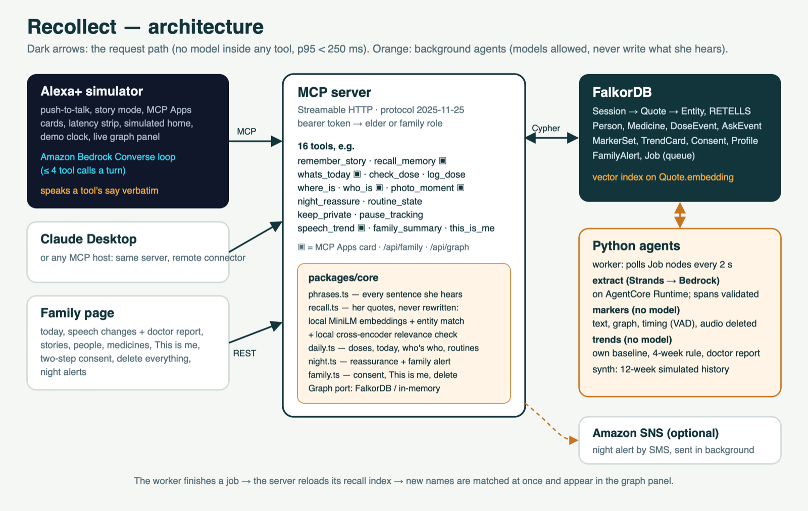

# Recollect

An Alexa+ companion for people living with early dementia or Alzheimer's, and for their families.
One memory graph does three jobs:

1. **Keeps their life memory.** Stories, people and places are stored in their own words. Answers
   about the past are always real quotes with the date they were said — never invented.
2. **Supports daily life.** "Did I take my tablet?", "What day is it?", "Who is this?", "Where is
   my grandson?" get the same calm answer every time. Repeats are logged silently, never mentioned.
3. **Notices change over time.** Everyday conversations become a speech sample that is compared
   with the person's **own baseline**. Recollect tells the family, gently, when a sustained change
   is worth mentioning to a doctor. **It never diagnoses. This is not a medical assessment.**

Built for Amazon's "Build, Ship, Shape" hackathon — Alexa+ track, AWS Builder mini-challenge, and the
Open Source mini-challenge with [`mcp-latency`](https://github.com/yash4428/mcp-latency).
All people, stories and speech histories in this repository are **fictional**.

> **Status (16 Oct 2026).** Everything in the spec is built and tested, including the P1 features.
> **Deployed on AWS** (one EC2 host, HTTPS) with the extract agent on **Bedrock AgentCore Runtime**
> and models on **Amazon Bedrock** (Amazon Nova Pro): a story told through the public MCP endpoint
> reaches the graph as people, places and things in about 8 s, and every tool passes the latency
> budget measured inside AWS. **Not yet done:** a real-microphone test. See
> [What exists today](#what-exists-today) and [docs/deploy-aws.md](docs/deploy-aws.md).



## The two analysis modes

A real Alexa+ add-on receives **text**, not the user's audio. So Recollect has two modes:

| Mode | Where | Input | Markers |
|---|---|---|---|
| **Alexa-native** | Works within real Alexa+ limits | Transcript text passed to MCP tools | Text and graph markers |
| **Full voice** | Recollect simulator and family page only, with explicit consent | Browser audio recorded in story mode | Adds timing markers (pauses, speech rate) |

## What exists today

| Part | State |
|---|---|
| `packages/core` — graph port, schema, phrase templates, grounded recall, daily tools, seed | Built, tested |
| `apps/mcp-server` — Streamable HTTP MCP server, 26 tools, role tokens, MCP Apps cards, family REST, `/api/graph` | Built, tested with a real MCP client |
| Grounding eval (`pnpm eval:recall`) | Passing, table below |
| FalkorDB adapter (`FalkorGraph`) | Built; seed and the 35-test core suite pass against FalkorDB (`FALKORDB_URL=redis://localhost:6379 pnpm test`) |
| Latency test (`pnpm test:latency`) | Passing locally on FalkorDB; deployed run still to do — see [Latency](#latency) |
| `agents/extract/validate.py` — span, orphan-relation and entity-resolution checks | Built, tested (`pytest`) |
| `agents/markers` — text, graph and timing marker maths | Built, tested |
| `agents/synth` — simulated 12-week history (`data/simulated/markers.json`) | Built, tested |
| `agents/trends` — baseline, sustained-change flags, family card, printable doctor report | Built, tested |
| `skill/SKILL.md` — Agent Skill with six example exchanges | Written |
| `agents/worker` + `agents/extract/agent.py` — Strands Agent on Bedrock extracts entities; validated graph writes, story prompts, marker sets; markers-only without Bedrock | Built, tested (scripted extractor, in memory and on FalkorDB). The extract agent ran live on Bedrock (Nova Pro, 15 Oct) on seed sentences; the full worker loop with Bedrock is **not yet run** |
| `agents/agentcore_app.py` — the extract agent as a Bedrock AgentCore Runtime agent | Deployed to AgentCore Runtime (`recollect_extract`, 16 Oct); the deployed worker uses it |
| Full-voice mode — consented story audio → `agents/markers/vad.py` → timing markers, audio deleted | Built, tested on synthetic audio; **not yet tried with a real microphone** |
| Night reassurance + family alert (`night_reassure`, optional SMS via Amazon SNS) | Built, tested |
| Live memory graph panel in the simulator | Built |
| `deploy/` — Dockerfiles for the MCP server, web (simulator + family page, password protected), worker, AgentCore | Deployed on AWS (16 Oct): `deploy/aws/` (Compose + Caddy on one EC2 host), see `docs/deploy-aws.md` |
| `packages/ui-cards` — MCP Apps cards: story, today, who's-who, trend, photo, Memory Lane | Built; served by the MCP server, tested |
| `apps/alexa-sim` — Echo-Show-style simulator: real MCP client, Bedrock Converse loop speaking `say` verbatim, story mode, cards, latency strip, simulated home, demo clock | Built; ran live on Bedrock (Nova Pro, 15 Oct): every demo question picked the right tool and spoke its `say` verbatim |
| `apps/family` — family page: today, speech changes + doctor report, stories, people, medicines, weekly photo, This is me, two-step consent, delete everything | Built; backend tested in memory and on FalkorDB |
| Memory fidelity, family memory network, care follow-through, Memory Lane, carer coach (22 Oct, below) | Built and tested in memory (107 JS tests, 51 Python); **not yet on the AWS deployment or in the demo video** |

Picking this up? Start with [docs/handoff.md](docs/handoff.md).

### How change tracking decides

`agents/trends/detect.py`. The baseline is the person's own first 14 days (at least 5
conversations): a median and a robust spread per marker. Each week's value is the median of that
week. A marker is flagged only when it has been 1.5 robust standard deviations worse than
baseline for **four weeks in a row**, and the family is told only when **two or more** markers
are flagged. One bad day, one bad week or one noisy marker never raises a card. Tested on
synthetic histories: stable, one bad week, three bad weeks, drift on one marker, drift that
recovered, and a change for the better all raise nothing.

The demo history is **simulated** and labelled so everywhere it appears. On it, the card reads:
"Since August, Gurdev pauses longer, uses fewer different words, names familiar people less
often and retells the same stories more often. Worth mentioning at the next check-up. This is
not a medical assessment." The report is at `data/simulated/doctor-report.html`.

Limits: parts of speech come from word lists and suffix rules, not a tagger, so
`pronoun_noun_ratio` and `idea_density` are rough; they are only ever compared with the same
person's earlier values. None of this has been run on real speech, and no marker has clinical
validity.

## Added on 22 Oct: the memory fidelity engine and family features

Built on the same graph and the same rules (her words only, fixed wording, no model in a tool,
family-only views never spoken to her).

- **Memory fidelity engine.** When she retells a story, the family page compares it with her first
  telling: which people, places and things stayed, which dropped out, which are new, a changed year,
  a possibly swapped name ("Nimmo in her first telling, Jagdish now"). Separately, a two-second
  "tell me about your day" chat (`talk_about_today`) lets Recollect compare her **recent** memory
  (did she name who visited, against the visit schedule) with her **long-ago** memory (how rich her
  old stories are). Recent memory usually fades first in memory loss (Ribot's law). She is never
  quizzed or corrected: whatever she says, she hears the same thanks. Family tool `memory_fidelity`.
- **Family memory network.** Family members add their own memory under one of her stories
  (`share_family_memory`, or the family page). It is stored with its own speaker and always
  attributed: "Aman told me on …". Recall still prefers her own words. A family member can leave a
  short **message** that is read to her after "Where is Aman?". The Memory Lane card and the printed
  memory book include these family voices.
- **Care follow-through.** When a sustained change card exists, Recollect prepares five steps for
  the family to approve: a pre-visit summary, questions for the doctor (one per changed marker),
  a check-up calendar invitation (.ics), a printable book of her stories, and a list of her tablets
  to check with the pharmacy. **Recollect never books, buys or orders anything**; it prepares, the
  family decides. Family tool `care_follow_through`, routes `/report/care-calendar.ics` and
  `/report/memory-book`.
- **Memory Lane** (`memory_lane`, MCP Apps card `ui://recollect/lane-card`): a slow slideshow of
  her richest stories in her own words, with a photo where one depicts the story, a family voice,
  a gentle "Would you tell me more about …?" and her music from the profile.
- **Carer coach** (`carer_coach`, family page "When things are hard"): reviewed guidance for asking
  for a parent, wanting to go out, repeated questions and evenings, each with a way in from her own
  stories (her actual sentence and date) and what calms her from the profile. Night alerts on the
  family page show the "going out" tip.

## Added on 23 Oct: her life in time, questions from the family, and care for the carer

- **Her life on a 3D timeline** (`apps/family/timeline.html`, three.js): every story she told is a
  glowing point on a river of time, placed at the year **she said in her own words** (gold) or a year
  **the family confirmed** (teal); anything else floats, undated, near "now" until someone places it
  (never guessed). Click a point for her exact words, the people and places in it, photos and family
  members' memories; threads join stories that name the same person or place; "Play her life" tours
  them in order. It polls every 3 s, so a story told to the simulator appears live, with a burst.
  Data: `packages/core/src/timeline.ts`, `GET /api/timeline` (either token), family tool `life_timeline`.
- **Ask Biji** (`packages/core/src/questions.ts`): a grandchild leaves a question on the family page
  or through Alexa (`ask_question`). In the calm afternoon window (15:00–16:30), at most once a day,
  `routine_state` says `questionDue` and Recollect asks her, in the family member's words and with
  their name (`family_question`). Her answer is kept verbatim as one of her stories, linked to the
  question; the family sees it on the page and on her timeline. "Not now" waits for another day.
- **Good morning**: in the morning `routine_state` carries the same calm greeting every day, built from
  today's sentence (visitors, next tablet), in her language.
- **This week** for the family (`weekly_digest`): stories, family memories, answered questions,
  tablets marked and the questions she asked most, plus **tablets not marked** an hour after their
  time ("Recollect never suggests a late or extra tablet to her"). Counts only.
- **And you?** A weekly check-in for the family admin with fixed, kind replies (P2 in the spec).

## Her first language: Hindi (23 Oct)

Gurdev can speak Hindi, English or a mix (Hinglish), and hear Recollect in Hindi. The family switches
it on the family page ("Her language"); the simulator has the same switch, and listens and speaks
with Chrome's Hindi (`hi-IN`) speech.

- **What she hears in Hindi** is fixed wording, like the English (`packages/core/src/phrases-hi.ts`):
  what day it is, visitors, tablets (checked against a Hindi banned-advice list as well as the
  English one), where someone is, who someone is, the evening and night routines, the day chat,
  "kept" and "kept private", and "nothing saved". The family writes Hindi status lines, relations
  and medicine names (seeded for the demo household).
- **Her stories are never translated.** A story told in Hindi is stored word for word in Devanagari;
  an answer about the past wraps her exact words, in whatever language she said them, in a Hindi
  sentence: `आपने 3 अगस्त 2026 को मुझे बताया था: "…"`.
- **Understanding Hindi.** In the simulator, her sentence is turned into one short English line
  before the model picks a tool (shown on screen as "Understood as: …"), so questions match the
  English memory index and names. This is in the client, before any tool call; tools still contain
  no model. The line is cut to one sentence: an early version let Nova append an explanation or an
  essay, which reached recall (friction log 32).
- **Not yet:** asking in Hindi about a story told in Hindi (the local embedding model is English),
  Punjabi, and speech markers for Hindi (tracking is only meaningful in the language the baseline
  was measured in). The family page, reports and cards stay in English.
- **Review needed:** the Hindi wording was written by the team and should be reviewed by native
  speakers and carers before real use.

## Vision (not built)

- **More of her language.** Punjabi; asking in Hindi about stories told in Hindi (a multilingual
  embedder, re-tuned on a Hindi grounding eval); speech markers validated per language.
- **Fire TV:** Memory Lane on the living-room screen in the evening routine, the family's photos
  large, her words as captions.
- **Ring:** when the doorbell rings, "That's Harpreet, your helper. She comes every morning", using
  the who's-who card, so a visitor is never a stranger.
- **Real voice messages** from family (today they are short text, read aloud), a village map in
  Memory Lane, and pharmacy and clinic integrations that still need a family member's approval.

## Setup

```
pnpm i && (cd agents && uv sync)
cp .env.example .env          # set ELDER_TOKEN and FAMILY_TOKEN; DEMO_CLOCK=1 for the demo
docker compose up -d falkordb
pnpm seed
pnpm dev                      # MCP server :8787, simulator :5173, family page :5174, agent worker
```

No Docker? Leave `FALKORDB_URL` empty and `pnpm dev` runs on an in-memory graph seeded at boot
(local development only; data is lost on exit).

The agent worker needs FalkorDB, so without it `pnpm dev` skips the worker and says so. Without
`uv`, `pnpm dev` runs the worker from `agents/.venv` if that exists. `pnpm i` also builds the MCP
Apps cards (`pnpm build:cards` to rebuild them).

The first run downloads two small local ONNX models (about 50 MB together) from Hugging Face.

```
pnpm test            # unit and MCP server tests, offline
pnpm eval:recall     # grounding eval with the real local models
pnpm test:latency    # 50 calls per elder tool against MCP_SERVER_URL
(cd agents && uv run pytest)
```

Demo tokens are whatever you set in `.env`: `ELDER_TOKEN` gets Gurdev's tools, `FAMILY_TOKEN` gets
the family's. Send one as `Authorization: Bearer <token>`.

## How grounded recall works

No model writes the spoken answer to a memory question (`packages/core/src/recall.ts`):

1. Embed the question locally (MiniLM, in-process) and find the people, places and things it names.
2. Candidates = sentences from stories that mention those entities, plus the top 8 by vector
   similarity. Score = 0.6 × cosine + 0.4 × entity overlap; below 0.45 → "nothing saved".
3. **Relevance check.** A small local cross-encoder (a classifier, not a generative model) asks
   whether a candidate answers the question — once as asked, and once with the names blanked out.
   Sharing a name is not an answer: "Where did Aman go to university?" must not return the story
   of his birth.
4. The answer is one or two of her sentences, at most 45 words, copied verbatim with the date:
   `You told me on 3 August 2026: "…"`. Otherwise:
   `I don't have anything saved about that yet. Would you like to tell me about it?`

### Grounding eval

`pnpm eval:recall`, seed household, real local models. Full table: [docs/eval-recall-latest.md](docs/eval-recall-latest.md).

| Set | Answerable: right story quoted | Unanswerable: "nothing saved" | Invented content |
|---|---|---|---|
| 30 questions (thresholds tuned on this set) | 20 / 20 | 10 / 10 | 0 |
| 10 held-out questions (written after tuning, never tuned on) | 6 / 6 | 4 / 4 | 0 |

Five of the unanswerable questions name a person she *has* talked about ("What was my mother's
name?"). Those are the hard case; the first version of recall failed four of them.
Limits: 40 questions on six stories is a small test, and the thresholds are fitted to it.

### Latency

Budget: p95 under 250 ms and no call at 500 ms or over, per tool, measured through a real MCP client.

Measured 14 Oct 2026 on a MacBook (Apple silicon, mains power) against FalkorDB in Docker,
50 calls per tool, round trip through the MCP SDK client:

| Tool | p50 ms | p95 ms | max ms | server p95 ms |
|---|---|---|---|---|
| remember_story | 3 | 7 | 16 | 6 |
| recall_memory (found) | 9 | 12 | 14 | 9 |
| recall_memory (nothing saved) | 1 | 2 | 4 | 1 |
| whats_today | 2 | 8 | 14 | 7 |
| check_dose | 2 | 8 | 9 | 8 |
| log_dose | 1 | 7 | 8 | 6 |
| where_is | 2 | 10 | 11 | 9 |
| who_is | 2 | 11 | 12 | 10 |
| keep_private | 24 | 38 | 39 | 37 |
| pause_tracking | 1 | 1 | 2 | 1 |
| story_prompt | 1 | 1 | 2 | 0 |
| photo_moment | 1 | 1 | 1 | 1 |
| routine_state | 1 | 1 | 3 | 1 |

**Passes locally.** An earlier run on a Windows laptop on battery did not pass: power throttling
slowed `recall_memory` roughly tenfold under sustained load (friction log 6).

**Against the deployed server** (16 Oct 2026, `https://34-194-181-93.sslip.io/mcp`, FalkorDB,
t4g.small, 50 calls per tool, through TLS and Caddy), run from inside AWS (the host itself, over the
public endpoint), as an Alexa+ caller would be: **passes**.

| Tool | p50 ms | p95 ms | max ms | server p95 ms |
|---|---|---|---|---|
| remember_story | 13 | 57 | 72 | 49 |
| recall_memory (found) | 42 | 93 | 97 | 72 |
| recall_memory (nothing saved) | 11 | 47 | 56 | 9 |
| whats_today | 16 | 71 | 74 | 63 |
| check_dose | 13 | 74 | 103 | 69 |
| log_dose | 9 | 72 | 76 | 67 |
| where_is | 7 | 80 | 92 | 75 |
| who_is | 7 | 10 | 14 | 5 |
| keep_private | 98 | 144 | 174 | 139 |
| pause_tracking | 5 | 9 | 83 | 3 |
| story_prompt | 5 | 10 | 10 | 4 |
| photo_moment | 6 | 10 | 35 | 5 |
| routine_state | 7 | 11 | 43 | 6 |

The same test from a laptop in India fails on round trip (p95 336–409 ms) while the server's own time
stays at p95 3–85 ms: about 280 ms of every call is the network between India and Virginia.

## Safety and consent

- **Never invents a memory.** Enforced by construction and by the eval above.
- **Never diagnoses.** Trend wording comes from fixed templates; a banned-word list is tested over
  every template (`packages/core/test/phrases.test.ts`). Every trend line ends
  "This is not a medical assessment."
- **Medicines:** fixed wording only; no advice. Unknown tablet → "please ask Simran".
- **Consent and control:** change tracking needs both the person and a family admin. "Stop tracking
  my speech" and "keep this private" work at any time. Family sees counts and trends, never private
  stories or audio.
- **Demo data is fictional**, and any multi-week trend shown is simulated and labelled so.

## Research basis

Reduced vocabulary diversity, more pronouns and vague words, and longer pauses are widely studied
linguistic changes in Alzheimer's speech research. Recollect compares these markers only with the
person's own earlier speech and makes no claim of clinical validity.

## AWS integrations

| Service | What it does in Recollect | Code |
|---|---|---|
| **Strands Agents SDK** | The extract agent: one `Agent` per sentence with `BedrockModel`, Pydantic structured output, temperature 0. It only *proposes* people, places, events and things; `extract/validate.py` decides what reaches the graph. | `agents/extract/agent.py` |
| **Amazon Bedrock** (Converse) | (1) The extract agent's model. (2) The Alexa+ simulator's conversation loop: MCP tools mapped to Bedrock `toolConfig`, ≤ 4 tool calls a turn, a tool's `say` spoken verbatim, `toolChoice: any` forced when a memory or medicine question is answered without a tool. | `agents/extract/agent.py`, `apps/alexa-sim/server/converse.ts` |
| **Bedrock AgentCore Runtime** | Hosts the extract agent (`BedrockAgentCoreApp`, `/invocations`); the worker calls it with `InvokeAgentRuntime` when `AGENTCORE_RUNTIME_ARN` is set. | `agents/agentcore_app.py`, `agents/extract/agentcore.py`, `deploy/agentcore.Dockerfile` |
| **Amazon SNS** | Optional SMS to the family for a night-time alert, sent in the background. | `apps/mcp-server/src/sms.ts` |

No model is called inside an MCP tool handler, and no model writes a memory, medicine or trend
sentence. Deployment steps: [docs/deploy.md](docs/deploy.md).

## License

MIT — see [LICENSE](LICENSE).
